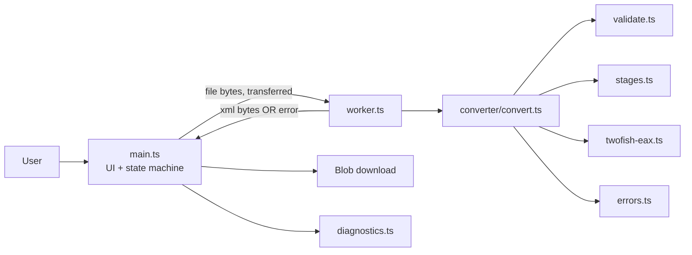

# Architecture

Assumes the recommendation in [TECHNICAL_FEASIBILITY.md](TECHNICAL_FEASIBILITY.md) §4 (browser-only conversion, approval pending: D-002). If the fallback to a separate service is triggered, this document must be revised first.

## 1. Shape
A static single-page site. No backend, no API, no database. All logic runs in the user's browser; the conversion runs in a Web Worker so the page stays responsive and can be hard-stopped.

## 2. Responsibilities and dependencies
| Module | Owns | Depends on | Must NOT |
|---|---|---|---|
| `main.ts` | DOM, drag/drop, state machine, worker lifecycle (create, timeout, terminate), Blob download | `diagnostics`, `errors` (types/messages) | Contain conversion logic |
| `worker.ts` | Message boundary: receive bytes, call `convert`, post result or serialized error | `converter/convert`, `errors` | Touch the DOM |
| `converter/convert.ts` | Pipeline order, per-stage timing, stage attribution on errors | `validate`, `stages`, `twofish-eax`, `errors` | Know about UI or Workers |
| `converter/validate.ts` | Input limits and sanity checks; output sanity checks; all numeric limits live here | `errors` | Decrypt anything |
| `converter/stages.ts` | Deobfuscation stages 1 and 3, `qUncompress` | `errors` | Contain crypto |
| `converter/twofish-eax.ts` | Twofish-128 + EAX decrypt with tag verification | `errors` | Know the Packet Tracer key (passed in by `convert`) |
| `converter/errors.ts` | `ConversionError`, error codes, user messages, stages | none | Import anything |
| `diagnostics.ts` | Conversion ID, structured console logging, "copy diagnostics" JSON | none | Log file contents or file names |

Dependency direction is one-way: `main → worker → convert → {validate, stages, twofish-eax} → errors`. `converter/*` is pure functions on `Uint8Array`, so it is unit-testable in Node without a browser.

## 3. Conversion lifecycle
1. **Select** (`main`): check a file exists; extension `.pkt` (convenience only); size ≤ limit. Show name and size.
2. **Convert** click: if state ≠ `selected`, ignore (duplicate-submit guard). State → `converting`; start watchdog; read bytes with `File.arrayBuffer()`; transfer to the worker.
3. **Worker** → `convert(bytes)`:
   1. `validateInput` (empty, too small for tag, too large)
   2. Stage 1 deobfuscate
   3. Twofish-EAX decrypt + tag check (**the real validity test**)
   4. Stage 3 deobfuscate
   5. `qUncompress`: header size ≤ cap, inflate with output cap, inflated length equals header size
   6. `validateOutput` (non-empty, begins with `<` after optional BOM)
4. **Result** → `main`: build `Blob` (`application/xml`), enable Download, show output size. State → `done`.
5. **Download**: anchor with `download="<sanitized original basename>.xml"`; revoke the object URL on reset.
6. **Convert another**: terminate worker, revoke URL, clear state, return to `idle` (no reload).

States: `idle → selected → converting → (done | error) → idle`. Any state can go to `idle` through Reset. A file chosen while `converting` is ignored.

## 4. Error model
One error type, `ConversionError { code, stage, userMessage, detail? }`. `detail` is for developers (sizes, offsets) and never contains file content. Stages: `input`, `deobfuscate1`, `decrypt`, `deobfuscate2`, `inflate`, `output`, `worker`, `ui`.

| Code | Stage | Trigger | User message (short) |
|---|---|---|---|
| `E_NO_FILE` | ui | Convert with nothing selected | Choose a .pkt file first. |
| `E_BAD_EXTENSION` | ui | Name does not end in `.pkt` | Only .pkt files are supported. |
| `E_EMPTY_FILE` | input | 0 bytes | The file is empty. |
| `E_TOO_LARGE` | input | Above input limit | File is larger than the N MB limit. |
| `E_NOT_PKT` | input | Shorter than the minimum possible container (tag + stage framing) | This doesn't look like a Packet Tracer file. |
| `E_UNSUPPORTED_FORMAT` | input | Matches upstream's pre-v5 signature | Very old Packet Tracer files aren't supported. |
| `E_AUTH_FAILED` | decrypt | EAX tag mismatch | Couldn't decrypt: file is corrupted, not a .pkt, or from an unsupported Packet Tracer version. |
| `E_INFLATE_FAILED` | inflate | zlib error or size header mismatch | Decryption worked but the content is damaged. |
| `E_OUTPUT_TOO_LARGE` | inflate | Header size or inflated bytes above cap | Converted XML would be too large for the browser. |
| `E_EMPTY_OUTPUT` | output | Zero-length result | Conversion produced no data. |
| `E_OUTPUT_NOT_XML` | output | Does not start with `<` | Conversion produced something that isn't XML. |
| `E_TIMEOUT` | worker | Watchdog fired | Conversion took too long and was stopped. |
| `E_WORKER_FAILED` | worker | Worker `error`/`messageerror`, or Workers unavailable | Your browser couldn't start the converter. |
| `E_OUT_OF_MEMORY` | worker | Allocation failure caught | The file is too big for this device's memory. |
| `E_DOWNLOAD_FAILED` | ui | Blob/anchor failure | Download failed. Try the button again. |
| `E_UNEXPECTED` | any | Anything uncaught; wrapped at the worker boundary | Something went wrong. Copy diagnostics and report it. |

Network-interruption and server-error cases from the brief do not exist in this architecture (no requests). The CSP makes that a testable guarantee.

## 5. Diagnosing a failed conversion
`diagnostics.ts` creates a short random conversion ID and logs one structured console line per stage (`id, stage, ms, inBytes, outBytes`) and one on failure (`code`, `detail`). A "Copy diagnostics" button copies a JSON blob: app version, upstream commit, conversion ID, code, stage, sizes, browser string. **No file names, no file content.** Debug path: code → stage → owning module (table in §2) → the unit test for that stage.

## 6. Why this is the smallest reliable shape
- No server means no upload limits, no temp files, no process execution, no retention, no secrets, no cost.
- One pure `converter/` folder holds everything that must be correct; the UI and worker are thin.
- Reference-oracle testing against the original binary replaces trust in reimplemented crypto.
